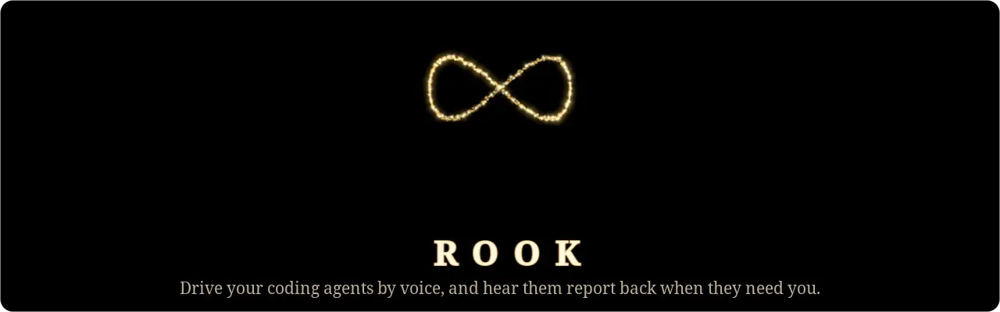

<picture><source media="(prefers-color-scheme: dark)" srcset="docs/banner/banner-dark.webp"></picture>

# Rook

Rook is a voice assistant for your desktop. You hold a key, speak, and Rook answers out loud. A small swarm of particles on your screen shows what Rook is doing: listening, thinking, speaking, or drawing a diagram.

Rook runs on a coding agent that you already use: Claude Code, Codex, Antigravity, or Pi. It hands long work to your own agent threads in T3 Code or Herdr, follows them for you, and tells you when they need you.

## What Rook needs

- Linux with Hyprland. Rook is built and tested on Omarchy, an Arch setup with Hyprland. Other Linux desktops are not supported yet.
- Or an Apple Silicon Mac. The one-command install supports it. It is tested in a scratch home folder only, not on a fresh Mac yet.
- One agent CLI, installed and signed in: Claude Code (`claude`), Codex (`codex`), Antigravity (`agy`), or Pi (`pi`).
- A microphone and speakers.
- About 750 MB of disk for the speech models. The medium voice adds about 3.3 GB, or 2.5 GB on a Mac.
- For the medium voice: an NVIDIA card from the RTX 20 series on with 6 GB of graphics memory, or an Apple Silicon Mac with 16 GB of memory. Without one, Rook uses its small voice, which runs on the processor.

## Install

Run the one command in [INSTALL.md](INSTALL.md). It installs uv when it is missing, gets the code, and runs the installer. Or open your agent in this folder and say "install Rook by following INSTALL.md".

The installer picks the medium voice when this computer can run it. To keep the small voice, add `--voice small`. [INSTALL.md](INSTALL.md#models-and-licences) lists every model Rook downloads and its licence.

## First run

When Rook starts, hold the talk key and say "run onboarding". The talk key is Right Control on Linux and Right Option on a Mac. Rook then leads the setup by voice. It takes a few minutes:

1. On a Mac, Rook first asks for the microphone and Input Monitoring.
2. Rook asks what to call you, and which pronouns to use.
3. You choose the key that wakes Rook.
4. Rook finds your coding tool (T3 Code, Herdr or Pi) and where your projects live.
5. You choose how careful Rook's own agent is: careful, automatic, or full. Full is the default.
6. With T3 Code, Rook offers a build thread that changes Rook's own code, and the Everystate checker for it.
7. Rook offers one shared memory for your Claude Code projects, and one shared setup for your agents.
8. You choose whether Rook may take screenshots.
9. Rook plays its voices, and you pick one.
10. Rook applies your choices. Then it offers you a short tour.

Apart from the Mac permissions, Rook changes nothing until it applies your choices. Say "skip" to take the default for a step, or "stop" to end setup with nothing changed. To try the setup without changes, say "do a dry run of setup".

## Things to say

Hold the talk key, speak, and let go. Some examples:

- "Fix the failing test in this project." Rook hands the work to a T3 Code thread and follows it.
- "How is that going?" or "What needs me?" Rook reports on your threads.
- "Tell it yes." Rook answers a thread that waits for you.
- "Show me the render." Rook opens a picture or a video in its viewer.
- "Pause the video." or "Play the music." Rook controls your media players.
- "Change your voice." or "Talk a bit faster." Rook changes its own settings.
- "Go dark for an hour." Rook goes quiet, takes no screenshots, and holds its messages until it comes back.
- "Save this to Obsidian. Try the west entrance on the next run." Rook appends the note when a vault is configured.
- "Stop." Rook stops what it is saying.

Rook answers in short spoken sentences. It shows longer answers as text on the screen.

### Obsidian dictation

Set `ROOK_OBSIDIAN_VAULT` to the absolute path of your vault in the Rook service's environment. To change the default `rook` folder, set `ROOK_OBSIDIAN_FOLDER` to a single folder name at the vault root. On macOS, see [LaunchAgent setup](macos/README.md#obsidian-dictation).

Rook appends your words as a Markdown entry in `rook/YYYY-MM-DD.md` by default, using the service's local date. It creates the folder and file as needed and reserves `daily/` for your own notes. Say “Save this to Obsidian” followed by the note, or run `python3 desktop/relay.py obsidian-note "Your note"` while Rook is running. The service writes the entry through Rook's local relay.

## What is yours and what ships

Rook ships the same base to everyone:

- the core prompts that steer Rook;
- the skills in `skills/` and the plugins in `plugins/`;
- a starter personality, `prompts/personality.md`. The installer copies it to `~/.config/rook/personality.md` once, when you have none.

Everything else is yours. It stays on your computer, and an update never changes it:

- `~/.config/rook/`: your personality, your model preferences, your own skills in `skills/`, and your machines in `machines.json`.
- `~/.local/share/rook/memory/`: Rook's memory of you.
- `~/.local/state/rook/`: your session state, such as the journal and the logs.

Edit your personality file to change how Rook talks. You can also tell Rook, such as "be more playful".

## Privacy

- **Speech to text runs on your computer.** Rook uses AirType, an offline recogniser, with Parakeet English or Parakeet multilingual (25 European languages). Your voice recording never leaves the machine.
- **Both voices run on your computer.** You can point the medium voice at a server of your own instead. Rook then sends the text it speaks to that server.
- **Your agent sees your request.** Rook sends the words you said to the agent you chose. With a spoken request, it also sends a screenshot of the focused window. That agent sends them to its own provider, such as Anthropic, OpenAI, or Google. Their terms apply.
- **Delegated work goes to your threads.** Rook sends briefs to your own T3 Code or Herdr threads, on machines you set up.
- **Rook's memory stays local.** Rook keeps its notes in `~/.local/share/rook/memory`. A nightly tidy reads them with your agent, so it uses your own model quota.
- Rook adds no permission layer of its own. Your agent's own permission mode decides what runs without asking.

## Contributing

Run `scripts/release-checks` before you send a change.

## Licence

Rook is released under the MIT licence. See [LICENSE](LICENSE). The speech models it downloads have their own licences, listed in [INSTALL.md](INSTALL.md#models-and-licences).
